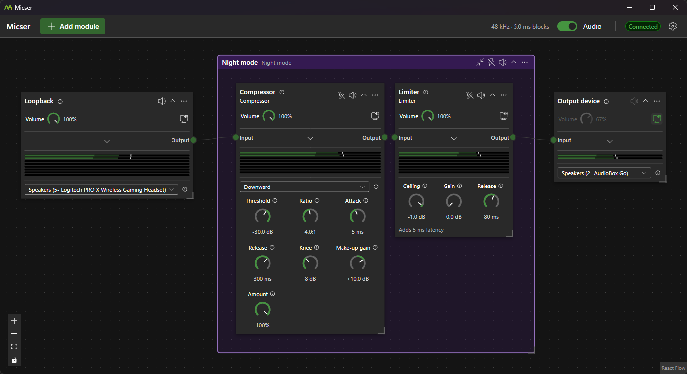
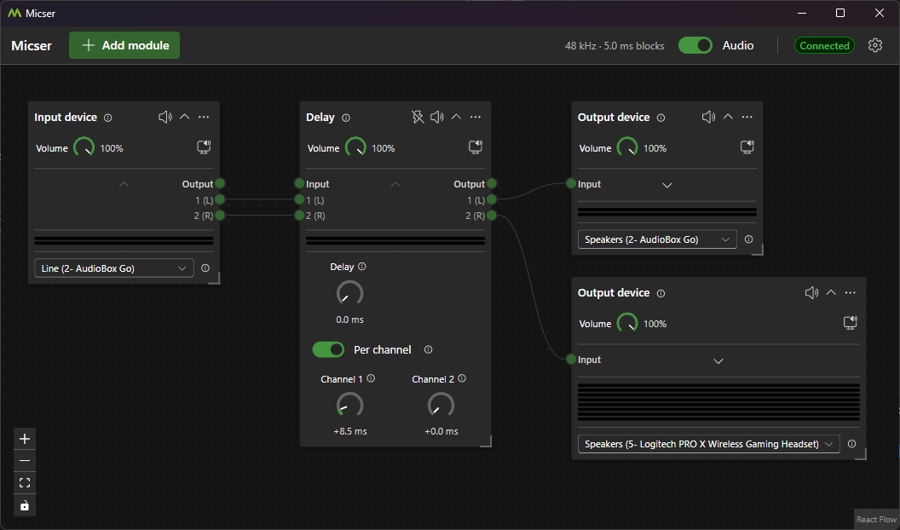
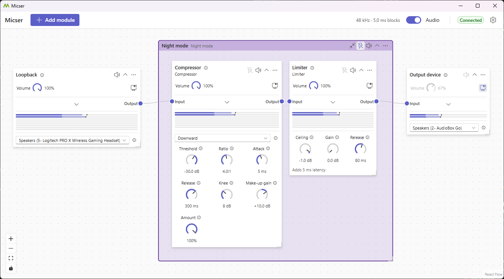

# Micser

Micser is a modular audio routing and effect application for Windows and Linux.

The application consists of:

- an audio engine that runs as a background process in the user's session and exposes a local HTTP API
- a web UI (React) for routing audio graphically using widgets, hosted in a small tray application (Avalonia, with WebView2 on Windows
  and WebKitGTK on Linux)
  - the UI closes when minimized to the system tray to minimize memory usage
- virtual audio cables with a configurable number of devices: on Windows a driver (WIP, still requires an extended validation code signing
  certificate), on Linux PipeWire devices that the engine creates itself

[](https://github.com/loreggia/micser/actions/workflows/ci.yml?query=branch%3Amain)

## Showcase


_Loopback / Night Mode template / Output_


_Single channel routing_


_Different light and dark themes (including high-contrast options)_

## Installation

Grab the latest release from the [Releases](https://github.com/loreggia/micser/releases) page.

- **Windows:** download either `Micser-win-Setup.exe` for the installer (installs for the current user) or `Micser-win-Portable.zip` for the
  portable version.
- **Linux:** download `Micser.AppImage`, make it executable (`chmod +x Micser.AppImage`) and start it. It needs PipeWire, WebKitGTK 4.1
  (`libwebkit2gtk-4.1-0` on Debian and Ubuntu) and `fusermount`. The app menu entry and starting at login can be turned on in the settings
  ("Desktop"). On GNOME, the tray icon needs the AppIndicator extension.

Both update themselves from the GitHub releases.

## Features

- **Graphical routing:** connect inputs, effects and outputs by dragging between their connectors; any output can feed several inputs and
  vice versa. The audio keeps running while the UI is closed.
- **Single channel routing:** show a module's channels to route each channel on its own, e.g. the channels of an audio interface that has
  them all on one device. Effects can be set to a fixed channel layout (mono, stereo, quad, 5.1, 7.1 or up to 64 channels).
- **Modules:**
  - device input, loopback input (capture what a device plays) and device output
  - gain
  - equalizer with peaking, shelf and pass bands and a preamp, which can import Equalizer APO configurations (e.g. AutoEQ headphone
    corrections)
  - high-pass and low-pass filter, compressor, limiter, noise gate, ducker (with a sidechain input), delay, pitch shifter and stereo tools
    (swap, mono, width, balance, polarity)
  - spectrum analyzer, and frequency response graphs for the equalizer and the filter
  - every module has a volume and mute, which can follow the system volume, so the volume keys also control routes into virtual cables
    and other devices; effects can be bypassed
  - knobs take typed values such as "2.5k", and info buttons explain each module and setting
- **Subgraphs and templates:** group modules into subgraphs that can be collapsed, muted and bypassed as a whole, and save them as
  templates to reuse. Built-in templates: "Footstep boost", "Night mode", "Music ducking" and "Voice chat mic". Subgraphs
  created from a template can be updated when it changes.
- **Virtual audio cables** to route audio between applications (built in on Linux, the Windows driver is still WIP).
- **Plugins** add new modules and their widgets (see [Plugins](#plugins)).
- **Configuration export and import**, e.g. as a backup or to move to another computer.
- **Themes:** default, blue, purple and high contrast, each light or dark, or following the system.
- **Languages:** English and German.
- **Automatic updates** from the GitHub releases, with release notes in the app, and an optional start at login.

## Building

### Requirements

- .NET SDK 10.0.100 or later (see `global.json`)
- Node.js 26 and npm 12 (npm enforces both; Node 26 ships npm 11, so `npm install -g npm@12`); with [Volta](https://volta.sh), the versions pinned in `package.json` are used
- Windows: WebView2 Runtime (included in Windows 11)
- Linux: PipeWire and WebKitGTK 4.1 to run the engine and the shell; [PowerShell](https://learn.microsoft.com/powershell/scripting/install/install-ubuntu) for `scripts/pack.ps1`

### Commands

```sh
dotnet build Micser.slnx
dotnet test --solution Micser.slnx

npm run setup          # npm install, then local dotnet tool install (git hooks via Husky.Net)
npm run build          # production build of the web UI (before dotnet publish of the engine, which serves it)
npm run lint
npm run format:check
```

### Running for development

With the [Aspire CLI](https://aspire.dev), `aspire start` runs the engine and the web UI with a dashboard for logs and traces; the shell can be started from the dashboard. Without Aspire:

```sh
dotnet run --project src/Engine   # engine on http://127.0.0.1:5080
npm run dev                       # web UI on http://localhost:5173, proxies /api and /hubs to the engine
dotnet run --project src/Shell -- --ui http://localhost:5173   # optional: the tray app showing the dev UI
```

### Packaging

```powershell
./scripts/pack.ps1 -Version 0.1.0   # Velopack packages in artifacts/releases: Setup.exe on Windows, Micser.AppImage on Linux
```

Pushing a tag `vX.Y.Z` builds the release on GitHub Actions and publishes it as a GitHub release, which installed copies update from.

### Driver

The virtual audio cable driver (`src/Vac`) is not part of `Micser.slnx`. It needs Visual Studio with the Windows Driver Kit component and the Spectre-mitigated libraries; the WDK itself comes from NuGet.

```powershell
./scripts/build-vac.ps1 -Platform x64,ARM64   # test-signed driver packages in src/Vac/bin
./scripts/codeql-vac.ps1                      # Microsoft's CodeQL driver checks
```

## Plugins

Audio modules are provided by plugins. Each plugin consists of a .NET project and a web package with the widgets for its modules. The main modules (device input/output, gain, compressor, ...) are provided by `src/Plugins/Main`, which also serves as an example of how to implement a plugin.

Plugins outside this repository build against the SDK packages, released with each version of Micser:
[`Micser.Audio`](https://www.nuget.org/packages/Micser.Audio) (NuGet) for the modules and
[`@micser/web-sdk`](https://www.npmjs.com/package/@micser/web-sdk) (npm) for the widgets.

## Architecture

The architecture is described in [docs/Architecture.md](docs/Architecture.md).

The previous WPF version is commit `9386ea4` in the history of `main`.

## Credits

This project uses the following libraries and tools:

Engine and shell

- [NAudio](https://github.com/naudio/NAudio) (audio I/O on Windows, resampling)
- [PipeWire](https://pipewire.org/) (audio I/O and virtual cables on Linux)
- [ASP.NET Core](https://github.com/dotnet/aspnetcore) and [SignalR](https://learn.microsoft.com/aspnet/core/signalr/) (engine API)
- [Serilog](https://serilog.net/) (logging)
- [OpenTelemetry .NET](https://github.com/open-telemetry/opentelemetry-dotnet) (telemetry in development)
- [Avalonia](https://avaloniaui.net/) and [Avalonia WebView](https://github.com/AvaloniaUI/Avalonia.Controls.WebView) (shell: tray, window, dialogs)
- [WebView2](https://learn.microsoft.com/microsoft-edge/webview2/) and [WebKitGTK](https://webkitgtk.org/) (the shell's web view on Windows and Linux)
- [Velopack](https://velopack.io) (installer and updates)

Web UI

- [React](https://react.dev/)
- [Fluent UI React](https://react.fluentui.dev/)
- [React Flow](https://reactflow.dev/) (`@xyflow/react`, routing graph)
- [TanStack Query](https://tanstack.com/query)
- [i18next](https://www.i18next.com/) and [react-i18next](https://react.i18next.com/)
- [markdown-to-jsx](https://github.com/quantizor/markdown-to-jsx) (release notes)
- [Vite](https://vite.dev/)
- [Orval](https://orval.dev/) (API client generation)

Driver

- [Windows Driver Samples](https://github.com/Microsoft/Windows-driver-samples) (the VAC driver is based on SimpleAudioSample)
- [Windows Driver Kit](https://learn.microsoft.com/windows-hardware/drivers/) and [CodeQL](https://codeql.github.com/) (driver build and checks)

Development and tests

- [Aspire](https://aspire.dev) (development orchestration)
- [TUnit](https://github.com/thomhurst/TUnit) and [NSubstitute](https://nsubstitute.github.io/) (.NET tests)
- [Vitest](https://vitest.dev/) and [Playwright](https://playwright.dev/) (web and end-to-end tests)
- [TypeScript](https://www.typescriptlang.org/), [ESLint](https://eslint.org/) and [Prettier](https://prettier.io/)
- [CSharpier](https://csharpier.com/) (C# and MSBuild formatting) and [Husky.Net](https://alirezanet.github.io/Husky.Net/) (pre-commit hook)
